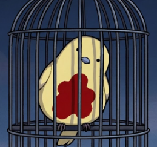

<div align="center">



# 金丝雀小助手 · CanaryAssistant

**100% vibe coding 的 Limbus Company 自动化实验项目**

Windows x64 · 图像识别 + OCR · 持续试验中的 Pre-release

[下载预发布版](https://github.com/Small-tailqwq/AhabAssistantLimbusCompany/releases) · [使用指南](assets/doc/zh/How_to_use.md) · [反馈问题](https://github.com/Small-tailqwq/AhabAssistantLimbusCompany/issues) · [English](assets/doc/en/README_EN.md)

</div>

> **使用前请知悉：本项目是 AALC 的非官方 fork，主要用于实验与测试，仅不定期维护。** 功能可能不稳定，问题不保证及时修复；使用前请充分了解并自行承担运行失败、误操作及游戏账号相关风险。
>
> **如果只是想使用 AALC 完成日常，建议选择 [AALC 原项目官方稳定版 →](https://github.com/KIYI671/AhabAssistantLimbusCompany/releases/latest)**

本分支以 **100% vibe coding** 的方式推进：由人提出需求、判断结果，AI 编写和重构代码，再通过日志、截图与实机运行排查问题。不承诺无人值守可靠性、全环境兼容或游戏账号安全。

目前覆盖日常经验本与纽本、换体与模块合成、奖励领取、镜牢及队伍轮换，并提供主题包权重界面、模拟器接入和实验性桌面分身。具体变化见 [更新日志](CHANGELOG.md)，已验证范围见 [项目现状](docs/project-status.md)。

## 开始使用

1. 在本仓库 **Releases** 中选择 Pre-release，下载 `AALC_<版本>.7z`，完整解压后运行 `AALC.exe`。
2. 核对游戏路径、语言、分辨率、队伍和任务次数；首次使用先跑少量任务并观察日志。
3. 默认 `Ctrl+Q` 请求停止，`Alt+P` / `Alt+R` 暂停或恢复；等待界面恢复空闲再重新开始。

[使用与更新](assets/doc/zh/How_to_use.md) · [常见问题](assets/doc/zh/FAQ.md) · [配置指南](assets/doc/zh/Custom_setting.md) · [文档索引](docs/README.md)

<details>
<summary><strong>功能与实验边界</strong></summary>

- 日常：经验本、纽本、狂气换体、模块合成，以及邮件、日常/周常和通行证等级奖励。
- 镜牢：队伍轮换、体系与商店策略、主题包识别和权重设置。成功率受队伍、游戏版本与画面变化影响。
- 运行方式：PC 前台/后台输入、模拟器；桌面分身通过 Windows Child Session 运行，需要额外兼容性条件。
- 实验功能：桌面分身、OBS 截图、罗技/雷蛇驱动输入等需要分别配置和验证，首次运行无需全部启用。
- 界面与游戏资源主要覆盖简体中文、英文；macOS、Linux 和 ARM 不在当前发行包支持范围内。

</details>

<details>
<summary><strong>从源码运行与参与开发</strong></summary>

Windows、Python 3.12+、uv。在仓库根目录执行：

```powershell
git clone https://github.com/Small-tailqwq/AhabAssistantLimbusCompany.git
cd AhabAssistantLimbusCompany
uv sync --frozen
uv run python .\main.py
```

[开发指南](assets/doc/zh/develop_guide.md) · [构建指南](assets/doc/zh/build_guide.md) · [翻译与资源](assets/doc/zh/translateGuide.md)

欢迎可复现的问题和范围明确的改动。反馈请附版本、运行方式、发生时间、相关日志与游戏画面；提交前移除账号信息和凭据。AI 生成的改动同样需要说明依据与实际验证结果。

</details>

<details>
<summary><strong>来源、许可与致谢</strong></summary>

本项目继承自 [AhabAssistantLimbusCompany](https://github.com/KIYI671/AhabAssistantLimbusCompany)，保留 AALC 的程序名与目录约定。「100% vibe coding」描述本分支的开发方式，不抹去上游代码与贡献者的工作。

代码许可见 [LICENSE](LICENSE)。第三方依赖、字体和游戏素材保留各自权利与许可，详见 [来源与致谢](docs/credits.md)。本项目与游戏官方无关联。

</details>
