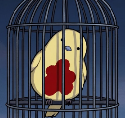

<div align="center">



# CanaryAssistant · Limbus Company

**A 100% vibe-coded automation experiment**

Windows x64 · Image matching + OCR · Experimental Pre-releases

[Download](https://github.com/Small-tailqwq/AhabAssistantLimbusCompany/releases) · [Getting started](How_to_use_EN.md) · [Report an issue](https://github.com/Small-tailqwq/AhabAssistantLimbusCompany/issues) · [简体中文](../../../README.md)

</div>

> **Before using: this is an unofficial AALC fork, primarily for experiments and testing, maintained only intermittently.** Features may be unstable and fixes may be delayed. Understand and accept the risks of failed runs, unintended actions and game-account consequences before using it.
>
> **For everyday AALC use, choose the [original project's official stable release →](https://github.com/KIYI671/AhabAssistantLimbusCompany/releases/latest).**

This fork uses **100% vibe coding**: people set goals and judge results; AI writes and refactors code, with logs, screenshots and live runs used to investigate failures. It makes no promise of unattended reliability, compatibility with every setup, or game-account safety.

Current workflows cover EXP and Thread Luxcavations, Enkephalin refills and modules, reward collection, Mirror Dungeons and team rotation. There are also theme-pack weight controls, emulator integration and experimental Desktop Clone support. See the [changelog](../../../CHANGELOG.md) and [project status and validation record (Chinese)](../../../docs/project-status.md).

## Start here

1. Choose a **Pre-release** from this repository, download `AALC_<version>.7z`, extract the entire archive and run `AALC.exe`.
2. Check the game path, language, resolution, teams and task counts. Start with a small run and watch the logs.
3. By default, `Ctrl+Q` requests a stop; `Alt+P` / `Alt+R` pause or resume. Wait for the UI to return to idle before restarting.

[Usage and updates](How_to_use_EN.md) · [FAQ](FAQ_EN.md) · [Configuration](Custom_setting_EN.md) · [Documentation index (Chinese)](../../../docs/README.md)

<details>
<summary><strong>Features and experimental limits</strong></summary>

- Daily tasks: EXP/Thread stages, Lunacy refills, module conversion, mail, daily/weekly missions and pass-level rewards.
- Mirror Dungeons: team rotation, gift systems, shop strategies and theme-pack weights. Results depend on teams, game updates and recognition.
- Execution: PC foreground/background input and emulators. Desktop Clone uses a Windows Child Session and has additional system requirements.
- Optional experiments: Desktop Clone, OBS capture and Logitech/Razer driver input each need separate configuration and verification.
- UI and game resources primarily cover Simplified Chinese and English. Current release packages target Windows x64; macOS, Linux and ARM are unsupported.

</details>

<details>
<summary><strong>Run from source and contribute</strong></summary>

Use Windows, Python 3.12+ and uv:

```powershell
git clone https://github.com/Small-tailqwq/AhabAssistantLimbusCompany.git
cd AhabAssistantLimbusCompany
uv sync --frozen
uv run python .\main.py
```

[Development guide (Chinese)](../zh/develop_guide.md) · [Build guide](build_guide_EN.md) · [Translation and resources](translateGuide.md)

Report the version, execution mode, timestamps, relevant logs and game screenshots. Remove account details and credentials before sharing. AI-generated changes need the same explanation of evidence and actual validation as other changes.

</details>

<details>
<summary><strong>Origins, license and credits</strong></summary>

This project is derived from [AhabAssistantLimbusCompany](https://github.com/KIYI671/AhabAssistantLimbusCompany) and retains AALC executable names and directory conventions. “100% vibe coding” describes this fork's development approach; it does not erase upstream authorship.

See [LICENSE](../../../LICENSE) and [credits and asset attribution](../../../docs/credits.md). Dependencies, fonts and game assets retain their respective rights and licenses. This is not an official game project.

</details>
