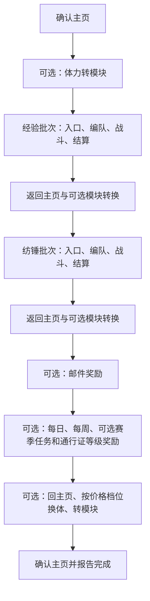

# 日常任务入口与交接

入口为桌面 `MainViewModel.RunDailyAsync` 与 CLI `daily`。二者组合相同的 `DailyRunner`、`GameSession`、`GameObserver` 和 `GameWindow`。业务配置为 `DailyOptions`；任务启动时保存配置快照，运行过程不再读取 UI 中的编辑值。

## 执行顺序

未启用的模块跳过；任一步失败或取消都终止剩余日常。关闭采光仍可独立转换模块；数量为零时不创建对应采光批次。`DailyPlan.Batches` 按总次数和连战上限生成批次；`DailyRunner` 持有任务顺序，`LuxcavationFlow` 只执行传入的一个批次。

| 步骤 | 输入与出口 | 详细说明 |
|---|---|---|
| 导航 | 识别主页的邮件及窗口／驾驶锚点；未知界面有界尝试，活动战斗不自动放弃 | `DailyNavigation.cs` |
| 采光 | 类型、批次数、队伍；同帧识别胜利与确认，点击结算后交回编排 | [采光与战斗](daily-combat.md) |
| 模块 | 当前体力；批量确认后观察按钮不可用或面板消失，单模块确认后核验体力减少 20；体力不足正常跳过 | [体力与奖励](daily-rewards.md) |
| 邮件 | 使用独立 `MailRunner`；返回完成、失败或取消 | [邮件流程](mail-flow.md) |
| 通行证 | 领取任务及等级选项；完成后停留通行证页 | [体力与奖励](daily-rewards.md) |
| 狂气 | 当日价格档位上限；每次消费后确认价格上涨，结束后转换模块 | [体力与奖励](daily-rewards.md) |

## 消费语义

经验与纺锤数量是各自计划的总场次。连战上限决定分组，不增加总次数。狂气 `RefillTier` 是每日价格上限：1、2、3 分别允许到 26、52、78；104 不会继续确认。每日已经购买的档位计入上限。

新任务不会从旧 `result.json` 自动恢复。中断发生在开战之后时，先查看最后的输入、截图和当前游戏状态，确认已进入的批次。CLI `daily-battle <pid> <当前批次数>` 只继续现有战斗，成功后停止；如需继续其余日常，应在新的配置中扣除已经完成的场次。该命令不判断批次类型，也不自动更新配置。

同一次任务内的游戏重启保留当前批次身份与已完成记录。返回主页时若确认当前批次的胜利结算，立即记录该批次完成，再继续后续批次。

## 观察与输入

`GameSession.ObserveAsync` 统一处理模板连接提示和服务器错误文字，正常后交回当前帧。已识别到调用方目标时，服务器全文检查在一次检查结束两秒后再次执行；未知页面或已进入服务器弹窗处理时立即检查。连战数量、局部关卡反馈、队伍列表拖拽与战斗回合控件使用 `ObserveControlsAsync`，省去周期性的整页服务器弹窗 OCR，保留模板连接检查。观察到 `base/try_again.png` 错误提示时，控件观察同样读取文字并处理重试按钮；名称选队只读取所需区域。

`ReadTextAsync` 接收明确的帧、可选区域及缩放倍数；`GameObserver` 缓存同帧同区域同倍率的结果。不同裁剪或倍率会改变识别输入，不能用整页结果代替。输入仍受 Windows 后端的五秒帧时效检查约束。

战斗回合需识别到详情按钮，或同时识别到胜率按钮和回合标识，才发送胜率按键。升级提示需要在相邻观察中位置稳定后再点击，以免战斗动画中的相似图案触发操作。

每个点击、按键和拖动关联帧标识。Session 拒绝过期帧引用；Windows 后端另行检查窗口、尺寸、帧年龄和客户区坐标。输入、截图、识别和等待均传播取消；结束任务后，未返回的原生调用仍持有窗口租约，防止另一个运行器同时接管。实现见 [Windows 运行接口](windows-runtime.md)。

## 诊断入口

每次运行保存 `events.jsonl`、截图和 `result.json`。桌面及完整日常 CLI 另存 `options.json`；继续当前战斗的 CLI 保存 `command.json`。事件含运行标识、帧号、规则名、动作、坐标或键名、相对时间以及观察详情。`Click`／`Key`／`Drag` 是输入请求，`Sent` 是输入返回，完成仍由后继观察和业务出口决定。

先定位首个失败规则及关联截图，再决定重放模板、OCR 或动作契约。`capture`、`match-many`、`read-text` 提供生产视觉路径；`daily-replay` 使用虚拟时间执行生产日常编排，见 [场景契约](scenarios.md)。合成动作场景验证流程分支，真实运行记录提供游戏界面的证据。

## 验证

[DailyReplayTests](../tests/AALC.Core.Tests/DailyReplayTests.cs) 验证完整编排和失败交接；[DailyCombatTests](../tests/AALC.Core.Tests/DailyCombatTests.cs) 验证连战、选队、战斗与事件。合成输入与真实截图的用法分别见 [场景契约](scenarios.md) 和 [截图回归](screenshot-regression.md)。
