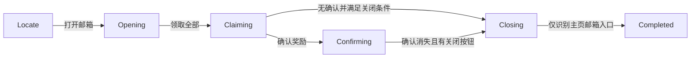

# 邮箱流程：源码与证据入口

本文对应当前工作树的邮箱实现。阅读顺序为入口、一次观察、决策、动作后的新观察、退出与接手者。

| 责任 | 入口 |
|---|---|
| 桌面启动、停止、结果展示 | [MainViewModel.cs](../src/AALC.Desktop/MainViewModel.cs)：`RunMailAsync`、`ReplayAsync`、`Stop` |
| 命令行真实运行与回放 | [Program.cs](../src/AALC.Cli/Program.cs)：`mail`、`replay` |
| 任务时间、取消、日志、输入调用 | [MailRunner.cs](../src/AALC.Runtime/Mail/MailRunner.cs)：`RunAsync` |
| 纯观察决策 | [MailFlow.cs](../src/AALC.Core/Features/Mail/MailFlow.cs)：`Decide` |
| 截图与四个控件识别 | [MailObserver.cs](../src/AALC.Vision/MailObserver.cs)：`ObserveAsync`、`Assets` |
| 合成观察、预期动作与验收 | [MailScenario.cs](../src/AALC.Runtime/Replay/MailScenario.cs)：`ScenarioSession`、`Evaluate` |

真实入口要求用户先启动游戏、恢复并选择目标窗口，退出旧版程序，并准备好可用的资源目录。可识别的起始观察为主页邮箱入口、邮箱领取按钮或奖励确认；当前入口不负责游戏启动、登录或从任意页面返回主页。

## 一次观察

真实运行由 `GameWindow` 截取客户区，`MailObserver` 在同一帧上识别全部四个控件。命中须有中心坐标、有限的相似度且分数至少为 `0.8`；`MailObservation.Find` 再检查分数。帧带编号、尺寸、窗口句柄和采集时间，输入使用该帧的目标坐标。

| 控件 | 相对资源 key | 作用 |
|---|---|---|
| `HomeMail` | `home/mail_assets.png` | 进入邮箱；关闭后识别主页 |
| `ClaimAll` | `mail/claim_all_assets.png` | 领取全部 |
| `Confirm` | `mail/get_mail_prize_confirm.png` | 奖励确认 |
| `Close` | `mail/close_assets.png` | 关闭邮箱 |

资源由 `TemplateMatcher` 按语言、主题解析；`MailObserver` 使用默认 `Clam` 搜索，没有 Python 流程中的逐步扩大模式。资源裁剪、缩放与匹配细节见 [vision.md](vision.md)，截图和鼠标契约见 [windows-runtime.md](windows-runtime.md)。记录目录启用时，观察器保存该帧灰度图，并在识别前发出 `FrameCaptured` 供预览。

## 决策与动作后的确认

每次运行从 `Locate` 开始；每轮只产生一次 `Wait`、`Click` 或 `Complete`。点击返回后记录 `Sent`，再等待 500 ms，下一轮获取新观察。`Sent` 表示输入接口返回，流程进展由后继观察决定。

图示为通常路径；实际优先级如下，不能只沿图推断允许的初始页面：

| 当前状态与观察 | 动作和下一状态 | 后继确认 |
|---|---|---|
| `Closing` | 只等待；看到 `HomeMail` 且没有另外三个控件时完成 | `Completed` / `mail.returned-home` |
| `Confirming` | 确认已消失且有 `Close` 时点击关闭，进入 `Closing`；否则等待 | 新帧应满足主页完成条件 |
| 其余状态存在 `Confirm` | 优先点击确认，进入 `Confirming`，不点击同帧背景按钮 | 新帧确认消失且出现 `Close` |
| `Claiming`，无 `Confirm` | 有 `Close` 且 `ClaimAll` 消失时关闭；`ClaimAll` 与 `Close` 连续出现两次时也关闭；否则等待 | 新帧应满足主页完成条件 |
| `Locate` 或 `Opening` 存在 `ClaimAll` | 点击领取，进入 `Claiming` | 新帧进入上述确认或关闭判断 |
| `Locate` 存在 `HomeMail` 且无 `Close` | 点击打开，进入 `Opening` | 新帧识别领取或确认控件 |
| 其他组合 | 保持状态并等待 | 下一帧重新判断 |

因此可以直接从已打开的邮箱或奖励确认页进入流程。`ClaimWaitFrames` 只统计进入 `Claiming` 后连续包含 `ClaimAll` 和 `Close` 的新观察；其他非确认观察将计数重置。打开、领取、确认、关闭均没有重复点击恢复；动作后状态不变化时继续等待至超时。

## 出口与父流程

C# 完成条件是关闭后的新帧仅识别 `HomeMail`。桌面入口显示结果、恢复命令状态；命令行写出结果并按 `Completed` 决定退出码。日常任务选中邮件时调用 `MailRunner`，完成后继续处理通行证；镜牢使用独立入口。

Python 对照入口是 [script_task_scheme.py](https://github.com/Small-tailqwq/AhabAssistantLimbusCompany/blob/ahab/tasks/base/script_task_scheme.py) 的 `to_get_reward`：配置 `set_get_prize_actions` 包含 `mail` 时，先 `back_init_menu()`，调用 [get_prize.py](https://github.com/Small-tailqwq/AhabAssistantLimbusCompany/blob/ahab/tasks/daily/get_prize.py) 的 `get_mail_prize()`，返回后再次由 `back_init_menu()` 接手，再按配置领取其他奖励。

Python 子流程先调用 `retry()` 处理公共状态，确认优先于领取；领取后最多进行两次间隔 500 ms 的观察，没有确认且领取按钮仍在时关闭。点击确认后会尝试关闭并返回，子流程本身不验证主页，父流程负责返回主页。C# 则显式等待确认消失、关闭后的主页观察，且没有移植 `retry()`、`back_init_menu()` 或公共弹窗恢复。

## 取消、超时与错误

`RunAsync` 在观察前、观察后、输入前及等待中检查取消；桌面停止按钮、窗口内 Esc 和 CLI Ctrl+C 取消同一任务令牌。取消返回 `Cancelled` / `mail.cancelled`，不撤销已经送出的游戏动作。鼠标抬键与恢复光标由 `GameWindow` 清理，窗口所有权在清理及未结束的原生截图完成后释放。

两个入口传入 30 秒超时。运行器在每轮开始、观察返回后和点击前检查已用时间，耗尽后返回 `Failed` / `mail.timeout`，超时观察不会触发点击。观察、识别或输入本身的结束时间仍取决于各接口的取消和等待契约。帧编号没有递增时返回 `Failed` / `mail.stale-frame`。观察、资源、输入等异常记录 `mail.error`，结果为 `Failed`，原因是异常消息。

日志包含运行 ID、帧编号、状态、规则、动作、目标与耗时；真实运行的入口写入 `events.jsonl`、`result.json`，观察器保存对应 `frame-*.png`。

## 已有证据范围

[MailTests.cs](../tests/AALC.Core.Tests/MailTests.cs) 覆盖确认优先、领取后等待、未知帧中断连续空邮箱观察、邮箱背景主页不能提前完成、取消或超时后不输入、旧帧拒绝，以及场景验收。三个 [JSON 场景](../scenarios/) 均标记 `synthetic-contract`，使用生产运行器与虚拟时钟，验证声明的观察和动作契约；具体来源及命令见 [scenarios.md](scenarios.md)。验收统一调用 `session.Evaluate(result)`，同时核对 outcome、reason、全部观察与预期动作及无契约违规。

Python 的 [test_get_mail_prize.py](https://github.com/Small-tailqwq/AhabAssistantLimbusCompany/blob/ahab/tests/test_get_mail_prize.py) 提供领取等待、空邮箱关闭和公共重试失败的 stub 测试源码。其三个用例仍断言返回 `float`，但当前 [日志装饰器](https://github.com/Small-tailqwq/AhabAssistantLimbusCompany/blob/ahab/module/decorator/decorator.py) 返回原函数结果，邮箱函数的相应分支返回 `None` 或 `False`；这些源码只能作为意图来源，此处没有宣称它们已通过。

## 实机记录

2026-10-25 使用 Steam 安装 build `25980202`、中文汉化、默认图像主题、1280×720 客户区验证；汉化版号未记录。截图和事件保存在本地忽略目录，未纳入 Git。

| 覆盖 | 本地证据（相对仓库根目录） |
| --- | --- |
| 奖励领取与确认 | `logs/dotnet_mail_debug/20261025-135959-519/`：帧 1、2、4、5 依次为主页、邮箱、奖励弹窗和确认后的空邮箱；作为分段证据 |
| 桌面完整空邮箱流程 | `logs/dotnet_milestone_debug/live-mail/desktop-20261025-140503/profile/runs/20261025-140627-759/`：主页→打开→领取尝试→关闭→主页，5 帧、2.636 秒，`mail.returned-home` |
| CLI 完整空邮箱流程 | `logs/dotnet_mail_debug/20261025-141351-795/`：5 帧、运行器 2.622 秒，退出码 0；进程测量见 `logs/dotnet_milestone_debug/live-mail/cli-20261025-141351/measurement.json` |
| 桌面停止按钮 | `logs/dotnet_milestone_debug/live-mail/desktop-20261025-140503/profile/runs/20261025-140759-687/`：等待阶段停止，`mail.cancelled`，界面恢复 |
| Esc 取消及再次运行 | `logs/dotnet_milestone_debug/live-mail/desktop-20261025-141032/profile/runs/`：`20261025-141142-244` 在首帧输入阶段取消，任务总历时 0.239 秒；`20261025-141257-892` 随后正常关闭邮箱并返回主页 |
| 实机超时与界面恢复 | `logs/dotnet_milestone_debug/live-mail/desktop-20261025-135633/profile/runs/20261025-135712-228/`：54 帧、30.247 秒，`mail.timeout` |
| 日常中的空邮箱 | `D:/AALCData/validation/unattended-20261027-163420/recordings/daily/20261027-164859-954/`：打开、尝试领取、关闭并返回主页，随后继续通行证 |

空邮箱完整路径已分别由桌面和 CLI 验证。有奖励邮件的领取、确认已有实帧证据；当前构建从主页领取新奖励再返回主页的连续成功记录仍需下一封可领取邮件。现有记录没有覆盖其他分辨率、汉化版本、语言和主题的实机行为。当前资源对上述真实帧的 Python/C# 对照见 [视觉接口](vision.md)。
