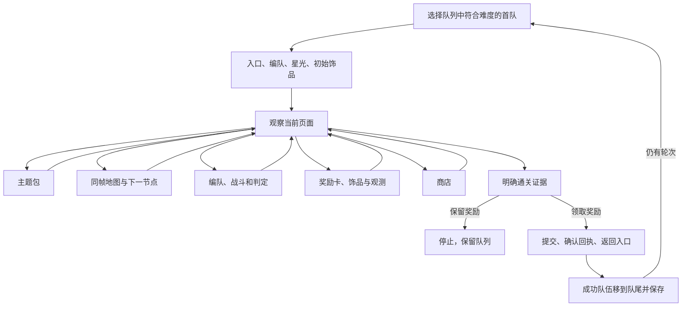

# 镜牢流程

桌面“镜牢”页与 CLI 使用同一个 [MirrorRunner](../src/AALC.Runtime/Mirror/MirrorRunner.cs)。配置由 [MirrorOptions](../src/AALC.Core/Features/Mirror/MirrorOptions.cs) 表达，独立保存到 .NET profile；Python 的配置文件不参与运行。[JSON 示例](../scenarios/mirror-options.example.json) 运行前应按实际编队修改编号、体系和罪人顺序。

镜牢入口连续点击“进入”至少间隔两秒；确认入口后，等待页面推进，避免在进入动画中反复点击背景。确认框长期未消失时按三秒间隔重试，入口按钮在确认后等待十五秒再允许重试。

## 运行所有权

`GameSession` 负责帧身份、输入检查、取消、网络错误与期限；`GameObserver` 负责截图、模板、OCR 和录制。日常与镜牢共用 `BattleFlow`、`BattleEvents` 和 `TeamSelection`。`BattlePurpose.Mirror` 要求战斗交回镜牢目的页；采光胜利确认不能直接完成整轮镜牢。

| 当前页面 | 处理者 | 返回依据 |
|---|---|---|
| 主界面、镜牢入口、选队、星光、初始饰品 | [MirrorEntryFlow](../src/AALC.Runtime/Mirror/MirrorEntryFlow.cs) | 新观察出现镜牢内部页面 |
| 主题包 | [MirrorThemeFlow](../src/AALC.Runtime/Mirror/MirrorThemeFlow.cs) | 难度明确、提交后观察到地图 |
| 地图、节点进入提示 | [MirrorRouteFlow](../src/AALC.Runtime/Mirror/MirrorRouteFlow.cs) | 同帧连接明确，进入后确认目的页 |
| 编队、战斗 | [MirrorFormationFlow](../src/AALC.Runtime/Mirror/MirrorFormationFlow.cs)、[BattleFlow](../src/AALC.Runtime/Automation/BattleFlow.cs) | 编队重排、开始战斗，观察到地图、奖励或最终结算 |
| 事件 | [MirrorEventFlow](../src/AALC.Runtime/Mirror/MirrorEventFlow.cs) | 地图、战斗或饰品页面；叙述页可通过右下 SKIP 与左侧正文交接 |
| 奖励卡、饰品、观测目录 | [MirrorRewardFlow](../src/AALC.Runtime/Mirror/MirrorRewardFlow.cs) | 确认或拒绝完成后出现明确出口 |
| 商店 | [MirrorShopFlow](../src/AALC.Runtime/Mirror/MirrorShopFlow.cs) | 交易验证后退出，观察到地图 |
| 最终结算 | [MirrorSettlementFlow](../src/AALC.Runtime/Mirror/MirrorSettlementFlow.cs) | 100%/clear 证据、模块确认、领取回执、返回入口 |

单轮最多两小时。无法识别的页面、有界重试耗尽或消费反馈缺失都会失败退出；取消不轮转队伍。截图和结构化事件留在录制目录。高频控件选择使用不附带整页 OCR 的观察；文字识别按实际区域请求。明确处于地图时，零散战斗控件匹配不会触发战斗处理或提前结束寻路。输入仍受窗口身份和五秒期限保护。

编队首先读取已选槽位及金色、青色顺位数字，实际集合和顺序均符合配置时直接复用。需要重排时，重置必须完成确认弹窗，并观察到弹窗关闭和空队；打开弹窗和点击确认各允许一次有反馈依据的补点。定位一次锚点后按数组顺序点击罪人，每次等待 120ms 并在新帧核对红色 SELECTED、青色 BACKUP 的槽位集合；只有恰好增加当前罪人才继续。旧横幅暂缺时在六帧内等待，只有连续六帧严格保持原集合才允许一次补点。单次选择未确认后，新帧仍显示编队及重置控件时，最多清空重建两次；选择是切换操作，恢复从空队开始，避免重复点击取消已选角色。全部确认后才开战，离开编队页或取消时不再发送选择输入。

## 队列与配置

`Teams` 的数组顺序就是轮换顺序。队伍名称、游戏编队编号、启用状态和适用难度分别保存；罪人顺序直接列出 1–12 的罪人编号。每轮取首个启用且符合难度的队伍，跳过不适用项；领取完成后将该队移至末尾。桌面立即保存队列；CLI 写 `queue.json`，输入的 JSON 保持原样。

`ClaimRewards=false` 时只运行一轮，确认通关后停在结算页，保留奖励及队列顺序。领取模式支持不使用、使用一次或使用全部当前选中的周奖励。取消周奖励后必须观察到选中数量下降；模块确认只发一次，缺少领取回执或返回页面时停止，保留记录供检查。

入口必须通过裁剪 OCR 明确读到 OFF 才进入常规镜牢；明确 ON 时关闭无尽模式并重新确认。星光转经费、十项增益等级、初始饰品优先顺序及每层重排罪人均为独立配置。主题包支持双语统一目录、按稳定 ID 设置权重、刷新次数和第四层活动包偏好，详见[主题与奖励](mirror-rewards.md)。

卡包页通过标题局部 OCR 确定实际楼层，读取成功后才执行该层偏好；暂不可读时等待新帧。进入新楼层后保留标题确认的值，地图过渡中的旧楼层不会覆盖它。直接恢复到未知地图时才从地图标题读层，失败后保留重读状态。

星光页通过完成按钮、标题与十卡布局定位，读取当前选中状态后补齐配置；每次输入等待动画并核对局部余额，提交前核对全部等级、成本和确认框余额。转经费开关在确认框内检查方框边线与白勾，目标状态明确后才确认。当前只接受已读可用额度内的配置，额外库存使用尚未验收。初始饰品按界面显示的可选上限，从 `InitialGifts` 优先序取前 N 件；计数与选中边框一致且已选满才提交。遇到剩余选择机会提示时取消提示，回到选择页补齐。

常驻饰品箱图标不单独构成奖励页证据；概率标签也不单独构成事件页证据。页面分派需要对应的操作控件，避免地图和卡包页被局部图像误匹配截获。弹窗动画或遮挡造成的匹配缺失，不作为已经清空选择或已经退出页面的依据。

奖励卡尚未选择时，先等待相邻两帧识别出的卡片种类和位置稳定，再按配置的优先顺序选择；动画期间的候选变化不会消耗选择重试次数。已选满后发送确认，等待至少三秒仍未离开才可再次确认。

## 当前策略范围

| 业务 | .NET 行为 |
|---|---|
| 常规与困难镜牢 | 明确选择难度、轮数与队伍，不自动根据周次数切换难度 |
| 地图 | 原生 ONNX 节点识别和明确连线规划，有限拖动视角；不使用键盘猜路 |
| 自动战斗 | 胜率选择、回合确认、鼠标反馈、失败重试、事件、升级提示与结算动画 |
| 礼物与主题 | 主副体系优先、白棉花排除、奖励卡排序、观测位置目录、自定义主题权重 |
| 商店 | 明确购买/保留/指定体系出售/已知配方策略、治疗、升级、刷新与技能替换，详见[商店范围](mirror-shop.md) |
| 旧版高级组合 | 自动周难度切换、三层退出、编队码粘贴、首回合防御与避开三技能未接入；随机合成、激进合成及合成后的策略切换不提供 |
| 其他任务 | 无尽镜牢、资源采集模式、模拟器和 OBS 不属于当前镜牢运行入口 |

## 验证与定位

确定性测试覆盖入口 ON/OFF、720p/1440p 编队坐标、战斗交接、奖励等待、主题权重、商店交易和队列结算。真实地图截图验证范围与失败帧记录见[地图与回放](mirror-route.md#已有证据与范围)。2026-10-25 在 720p 中文客户端完成同一轮普通镜牢的修复续跑：五层均为 6/6、总进度 100%，关闭周奖励后消耗五个模块领奖并返回游戏主页。入口星光消耗为配置的 50，商店按配置跳过。该轮包含修复、重启续跑及人工诊断操作。问题与证据索引在 `logs/dotnet_mirror_debug/live-20261025-192800/session.md`，通关帧为 `20261025-222613-979/frame-000093.png`，领奖结果为 `20261025-223349-846/result.json`。

2026-10-27 从入口到领奖完整运行一轮普通镜牢，五层通关后消耗五个模块并返回主页，期间没有人工补点或重启。记录为 `D:/AALCData/validation/unattended-20261027-163420/recordings/mirror/20261027-165805-186`，`result.json` 为 `Completed`，耗时 1733.7 秒。入口确认及奖励卡展开时出现重复或过早点击，之后加入入口点击间隔与卡片稳定判断；入口用模拟时序验证，奖励卡用该轮帧 735～738、879～882 的生产模板匹配验证。商店退出及奖励卡提交后的过渡帧出现重复输入，调整后的流程在帧 191～194、739～743 的生产模板和 OCR 回放中各仅发送一次确认。这些调整均在实机完成后加入，尚未重新实机跑完整镜牢。

录制含 `options.json`、`events.jsonl`、`frame-*.png`、`result.json`。`mirror.route.map` 保存同帧图谱；`automation.observe`/`automation.ocr` 保存模板查询和 OCR 请求；输入事件记录规则、帧、目标和发送结果。AI 定位时先从最后的 `mirror.*` 进度找到处理模块，再用同帧观察解释动作，最后调用 `mirror-replay --run <目录>` 核对生产流程。
