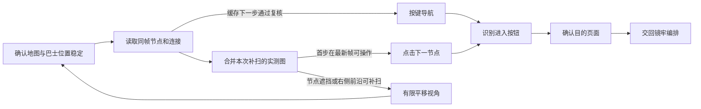

# 镜牢地图与录制回放

地图模块迁移自 [search_road.py](https://github.com/Small-tailqwq/AhabAssistantLimbusCompany/blob/ahab/tasks/mirror/search_road.py)，由 [MirrorRunner](../src/AALC.Runtime/Mirror/MirrorRunner.cs) 在地图或节点进入提示出现时调用。每轮只执行下一节点，完成后交回镜牢编排。后续路线缓存节点类别与相邻节点的相对位移；每次返回地图都重新核对下一节点与巴士连接。

## 接口与规划

```csharp
using var reader = new MirrorMapReader(Path.Combine(repository, "assets/model/best.onnx"));
var route = new MirrorRouteFlow(session, reader);
var result = await route.AdvanceAsync(new MirrorRouteOptions(HardMode: hard), cancellationToken);
```

[IMirrorMapReader](../src/AALC.Runtime/Mirror/MirrorRouteFlow.cs) 接收同一观察的 `PixelFrame` 与巴士模板中心，返回带 `FrameIdentity` 的 [MirrorMapSnapshot](../src/AALC.Core/Features/Mirror/MirrorRoutePlan.cs)。图谱包含节点类别、中心、包围盒、置信度与有向连接；巴士的节点编号为 `-1`。帧身份不一致时禁止继续输入。

[MirrorMapReader](../src/AALC.Vision/MirrorMapReader.cs) 使用仓库的 `assets/model/best.onnx`，保持正方形右侧/底部黑色填充、640×640 输入、0.25 检测阈值与 0.4 NMS。输入通道沿用 Python 的实际路径：PIL RGB 截图经过 `swapRB` 后为 BGR；.NET 直接从原始 BGRA 取得 BGR。模型的七类按原顺序映射为有类型节点。

| 节点 | 规划权重 |
|---|---:|
| 普通战斗 | 30 |
| 首领战斗 | 1 |
| 事件 | 18 |
| 集中战斗 | 75 |
| 精锐战斗 | 100 |
| 商店 | 1 |
| 异想体战斗 | 999 |
| 未分类节点 | 999 |

LSD 在线段所在帧上识别水平及斜向连接，按节点列分组，只有方向、位置与覆盖长度支持的相邻列连接才进入图谱。最短线段为 `20 * Scale`（720p 为 10 像素），保留双箭头遮挡后形成的短段；方向、垂距与合并去重后的覆盖要求同时生效，覆盖长度至少达到节点间距的 35%。巴士模板中心按 1440p 基准向下偏移 50 像素，作为其车道连接起点。节点坐标与缩放均来自当前帧。

连接的水平跨度不得超过 `640 * Scale`，避免模型漏掉中间一列时跨过商店直连首领。已知节点不能形成巴士路线时，可从地图区域的橙色 WARNING 外圈补充未分类候选；必须满足外圈形状、同帧实际连线及唯一可达候选约束，不推测其战斗类别。未分类候选仍使用相同的进入后页面确认。

CLI 和桌面端将没有巴士连接或出现未分类节点的异常段首末帧保存到外部数据根的 `learning/maps`，并记录实际加载模型的 SHA256。原始预测保持待审核；AI 标注、训练与候选评估独立进行，运行中的模型不自动替换。流程决策见[AI 监督学习笔记](../../.agents/notes/proposed/feature/2026-10-26-map-supervised-learning.md)。

[MirrorRoutePlanner](../src/AALC.Core/Features/Mirror/MirrorRoutePlan.cs) 只沿已观察连接计算累计节点权重。普通模式优先寻找可达且没有实测出边的首领候选；没有这样的候选时，选最远可达列中累计权重最低的路径。已有出边的首领类节点会继续沿后继规划，不触发首领候选的提前停扫。困难模式只前瞻两个节点。没有从巴士出发的连接时返回无方案。节点类别和局部终点均不用于判定整层或整轮通关，通关由结算页面确认。

[MirrorMapScan](../src/AALC.Core/Features/Mirror/MirrorMapScan.cs) 在一次纯相机补扫期间合并观察。节点坐标以巴士下方的连接起点为原点，归一化到 1440p；跨帧关联的两个坐标分量误差均不得超过 16 基准像素。节点和连接保留来源帧及原始编号；未分类节点可由后续观察补全类别，两个已知类别冲突时标为争议并退出规划。合并图使用规划器的纯图入口，不伪造新的截图身份。实际选点必须重新匹配最新帧中的节点与巴士连接。

局部补扫不要求固定行数或列数，也不推算屏幕外的商店和首领。导航输入后的重新规划从新图开始；后续路线由独立的语义缓存保存。中途接手与楼层入口使用同一套当前巴士定位规则。

## 动作与确认

缓存匹配要求当前图中存在唯一同类别、相对位置一致且与巴士相连的下一节点。匹配后使用方向键导航；确认目的页后才消费该步。方向键与 Enter 未产生选中或页面转换反馈时，清除缓存并从新帧重新规划。加载中继续等待确认，不追加选点。

商店流程确认离店后，下一次地图操作先发送 W，并检查进入按钮或目的页；未确认导航时恢复地图识别。主题卡包确认换层或地图标题识别到不同楼层时清除路线缓存。中途接手从当前巴士和实际连线规划剩余路线，不依赖已经执行的节点数量。



- 地图标志为 `mirror/road_in_mir/legend_assets.png`，巴士为 `mirror/mybus_default_distance.png`，进入按钮为 `mirror/road_in_mir/enter_assets.png`。已有进入按钮时直接处理当前节点，不另选路线。编队、商店、事件或奖励覆盖层优先交回其处理者。
- 选点前间隔 120ms 观察巴士位置，连续两次位移不超过 `4 * Scale` 才在最新帧识图；最多十二次、首次等待最多两秒，持续移动时不点击。退出商店后的自动居中也走这一步。
- [MirrorMapViewport](../src/AALC.Core/Features/Mirror/MirrorMapViewport.cs) 根据实际节点包围盒计算避挡位移。1280×720 下的节点画布为 X=40～1200、Y=100～610，按帧高度缩放；巴士按自身模板包围盒保持可见。非零拖动分量至少为 `32 * Scale`，避免小位移未触发游戏拖动；保留巴士后空间不足的分量取消。右侧已见前沿接近画布边界且仍有平移空间时允许有限扩视，不将屏幕 Y 当成绝对车道。
- 一次选点及进入反馈中的补扫共享四次平移预算。每次根据实际巴士位移归一化观察，不用请求的拖动距离推算坐标。首步可操作且已有无实测出边的可达首领候选、继续补扫无新增信息或已到平移边界时结束扫描；首步仍不明确则停止选点。
- 点击识别出的节点中心后重新观察。进入按钮最多点击三次，间隔至少 1.25 秒，每次依据新帧；按钮持续可见时仍观察至 30 秒期限。目的页通过编队、战斗、主题、事件或饰品模板确认。无模板叙述事件使用共享 `BattleEvents.HasNarration` 判据交回事件处理器。
- 点击节点后连续三帧仍明确为地图与巴士、没有进入按钮和目的页，且尚未发送进入动作时，最多补选两次。每次重新稳定地图、读取图谱并计算坐标，未知页面不补点；仍受本次进入的 30 秒期限约束。
- 地图消失本身不算进入成功。`Entered` 表示已确认目的页；`NotMap` 表示调用时已在其他页面；`Failed` 表示地图识别、连接或进入反馈未完成。
- 所选节点的完整包围盒必须处于节点画布内。已见首步在最新帧暂时漏检且预计位置仍在画布内时，最多重新观察两次；历史坐标只用于调整相机。预算耗尽后仍被遮挡时返回 `node-outside-map`，无法复核首步时返回 `first-step-unconfirmed`，没有明确连接时返回 `no-confirmed-connection`。巴士缺失时停止选点。八次非加载反馈仍未完成进入时停止，明确加载提示最多等待 30 秒。
- 点击、拖动和按键通过 `IGameSession` 走现有后台输入。取消与总任务超时由共享 session 传播。

`mirror.route.map` 记录同帧图谱 JSON，`mirror.route.scan` 记录合并节点、连接及来源，`mirror.route.scan-pan` / `scan-complete` 记录补扫过程；`mirror.route.select-node`、`mirror.route.enter-node`、`mirror.route.align-camera` 记录实际动作。中文阶段进度使用独立 `Report`。

## CLI 与回放

```powershell
dotnet run --project dotnet/src/AALC.Cli -c Release -- mirror --profile "$env:LOCALAPPDATA\AALC.Next" --pid 12345
dotnet run --project dotnet/src/AALC.Cli -c Release -- mirror --options mirror-options.json --pid 12345
dotnet run --project dotnet/src/AALC.Cli -c Release -- mirror-replay --run D:\AALCData\recordings\mirror\<运行目录>
```

`mirror --profile` 每次启动直接读取桌面配置目录的 `settings.json`，包括镜牢队伍、资源仓库、语言、主题及 OCR 模型目录；桌面以自定义 `--profile` 启动时，CLI 使用同一目录。独立镜牢配置使用 `--options` 的 `MirrorOptions` JSON，两种来源互斥，执行前调用 `MirrorPlan.Validate`。可另传 `--root <仓库>` 与 `--models <OCR目录>`，省略 `--pid` 时必须只有一个游戏窗口。录制目录包含配置来源 `configuration.json`、实际使用的 `options.json`、`events.jsonl`、PNG 帧与 `result.json`；完成领奖后的队列顺序写入 `queue.json`，输入配置文件保持原样。

[MirrorScenario.LoadRun](../src/AALC.Runtime/Replay/MirrorScenario.cs) 读取录制目录。[MirrorScenarioReplay](../src/AALC.Runtime/Replay/MirrorScenario.cs) 默认使用虚拟时钟、原 PNG 像素、录制的 `automation.observe`/`automation.ocr` 与图谱，调用生产 `GameSession`、`MirrorRunner` 和路线规划。增加 `--vision <仓库>` 时，从原图重新运行模板、OCR 与地图识别；两种模式都不连接游戏输入。带人工标注、哈希与统一报告的批量入口见[截图回归](screenshot-regression.md)。新录制默认写入 `D:\AALCData\recordings\mirror`。

```csharp
var scenario = MirrorScenario.LoadRun(directory);
var replay = new MirrorScenarioReplay(scenario, readBgraPixels);
var result = await replay.RunAsync(cancellationToken);
var acceptance = replay.Evaluate(result);
```

验收同时要求最终 outcome/reason 匹配、观察与图谱全部消费、有序动作的规则/种类/坐标或按键匹配。OCR 区域和倍率也必须一致；缺少记录、剩余末帧动作或契约违规会失败。明确未发送完成的输入可重现其录制失败，录制的取消事件通过生产取消路径传播。修改流程后请求了未录制的观察或动作时，回放明确报告差异。

## 已有证据与范围

[MirrorRouteTests](../tests/AALC.Core.Tests/MirrorRouteTests.cs) 覆盖连接未知时停止、可见路径的累计权重、困难模式前瞻、相机后重新识别、输入帧身份、进入反馈与加载时限、取消和叙述事件交接。[MirrorReplayTests](../tests/AALC.Core.Tests/MirrorReplayTests.cs) 由 fake 图谱与页面组成一段地图进入、战斗回合及保留通关奖励的合成契约；先用生产 session/runner 录制，再用同一生产流程回放，覆盖图谱改变、坐标/OCR 差异、漏动作、具体退出原因、输入失败和取消。

2026-10-25 初次离线重放 `logs/route_map_debug` 中 2026-05-18/25 的 41 张既有地图截图，包含 1280×720 与 1920×1080：原生识别 362 个节点，巴士模板分数最低 0.9537，40 张能规划至少一步明确连接。结果保留在 `logs/dotnet_mirror_route_debug/route-reader-20261025/results.json`。

- `20260525_181418_933_best_plan.png`：原 Python 未形成完整计划。原生 C# 与 Python 离线管线的八个节点类别及中心逐项一致，当前图谱可确认巴士通往中间事件，只执行这一步。
- `20260525_181822_588_scout_plan.png`：模型漏掉巴士右侧可达的底部节点，因此没有从巴士出发的已确认连接。本实现保留失败，不虚构节点；静态帧不能验证调整视角后的恢复效果。
- `20260525_162218_078_best_plan.png`：配套 JSON 巴士为 `(104,516)`，保存截图的模板中心为 `(106,784)`。原生流程始终使用同帧模板位置，不使用该旧元数据坐标规划。

红线短段修复使用 `logs/dotnet_mirror_debug/20261025-211632-651/frame-000170.png` 与 `frame-000182.png` 验证。双箭头将路径切成约 11～14 像素的片段；保留这些片段后，去重覆盖长度分别从 83.78 增至 118.18 像素（要求 89.25）、从 83.83 增至 113.00 像素（要求 88.90），两帧均识别出唯一的巴士 `-1` → 首领 `0` 连接。节点类别、中心、包围盒与置信度不变。三张旧红/灰地图及两张旧蓝图的 50 条连接逐项保持，另有七个直接边界断言通过，包括空线段、覆盖不足、偏离车道、过短噪声和重复线段不重复累计。精确节点与连接证据保留在 `logs/dotnet_mirror_debug/red-lines-20261025/final-evidence.json`。

当前版本普通镜牢已在同一轮修复续跑中完成五层首领及领奖。attempt-14（`20261025-213506-786`）frame105 退出第四层首领战，frame123 的地图区域 OCR 识别“正在探索第5层”（置信度 0.99642）后才交接寻路；frame121/122 仍为第四层时保持等待。attempt-17（`20261025-220326-190`）通过第五层商店并选中最终首领节点。attempt-19（`20261025-222613-979`）frame93 显示五层各 6/6、总进度 100%；attempt-20（`20261025-223349-846`）关闭周奖励并领奖，frame11 返回游戏主页。该轮包含修复后续跑及人工诊断，不作为全新一轮无干预运行的验收。

2026-10-26 普通镜牢完整实机验收从游戏主页开始，使用第 1 队及顺序 `5,10,4,12,2,9,7`，连续运行 29 分 40.435 秒。录制 `D:/AALCData/validation/mirror-clean-pass-20261026/recordings/mirror/20261026-211348-357` 的 frame1190 显示五层各 6/6、总进度 100%，frame1199 已领奖返回主页。整轮没有人工补点、生产代码修改或任务重启。随后使用 recorded 模式离线回放全部 1199 帧，结果为 `scenario.accepted`，观察和预期动作全部消费；回放报告位于同一外部验收目录的 `replay.jsonl`。
